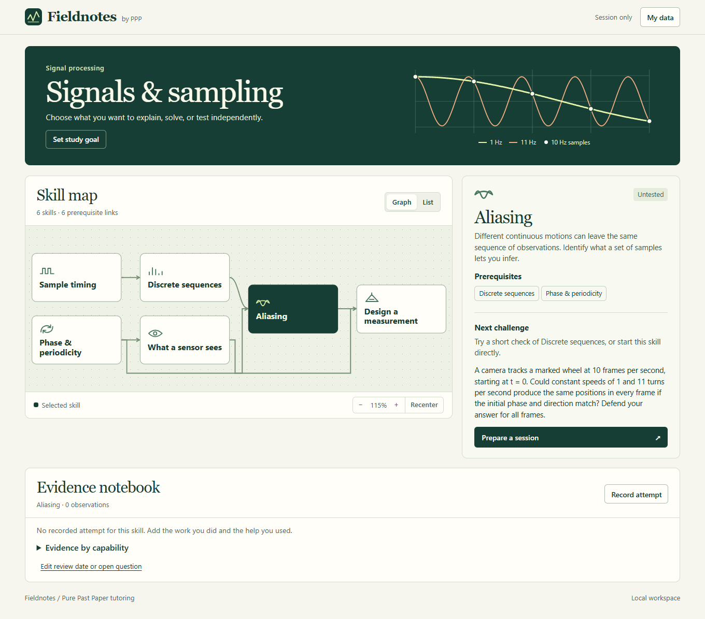

# Pure Past Paper tutoring

Bring a past-paper question, a line of working you distrust, or a mechanism you want to understand. PPP starts there. In exam practice, you try a problem, the tutor helps with the first step that needs repair, and you get a chance to try again independently. You can ask for the entire solution at any point.

> **Learner** — I divided both sides of `x(x − 4) = 0` by `x` and got 4. Give me one hint.
>
> **Tutor** — Your division assumes that `x` is nonzero. Which value did that assumption set aside?
>
> **Learner** — Zero. Both 0 and 4 work in the original equation.
>
> **Tutor** — Yes. Checking the original equation recovers the missing root. A fresh test would ask you to spot the same restriction in a different equation.

| What you want | How to ask | What happens |
|---|---|---|
| A direct answer under a deadline | “Give me the full solution now.” | The tutor gives the working immediately. |
| Exam practice or essay feedback | “Here is my attempt and the mark scheme. Where would I lose marks?” | Feedback uses the supplied criteria and actual work. Generated questions are labeled. Reserved papers stay closed. |
| Visual inquiry | “Show me how two different wheel speeds can look identical on camera.” | Compare a visual example, then change the sampling rate. [Download the interactive](assets/interactive.template.html) and open it in a browser or [watch the silent preview](examples/sampling-preview.mp4). |
| Read or research critically | “Does this passage support the author's claim?” | The tutor checks the available passage or identifies the evidence it still needs. |
| A technical project or roadmap | “Help me verify this counter in simulation. What should I predict before I run it?” | Connect a prerequisite to a prediction, trace and measurable checkpoint. |
| Continue studying | “Pick up from my last attempt. Which step still needs practice?” | The tutor reads the authorized handoff, checks its date and assistance, and proposes one next step. |

The core works in conversation. Codex discovers [the skill](SKILL.md) and loads specialized references as needed. Local tools validate records and select due items. Optional tools support checked browser activities, Manim animations and LaTeX study documents. REA can inspect a supplied software artifact on hosts that provide it. Superpowers can coordinate engineering work on the skill. Ordinary tutoring needs neither integration.

## Try a checked problem

Three original technical exercises come with the installed skill. Start with a learner sheet. In each folder, `key.md` contains a worked solution, grading, oral follow-ups and hints. Save `transfer.md` for a separate attempt and `transfer-key.md` for marking it.

| Practice | Decision to make |
|---|---|
| [Inspection cart](assets/challenges/technical-practice/rail-dock/problem.md) | Turn a spatial demand description into a cost function and defend a global minimum. |
| [FPGA register and firmware counter](assets/challenges/technical-practice/stream-register/problem.md) | Reconcile accepted and delivered beats when a downstream device stalls. |
| [Stereo depth](assets/challenges/technical-practice/stereo-depth/problem.md) | Decide which depth claims two uncertain measurements actually support. |

[Teaching research](docs/research-revision9.md) · [Revision 9 test and release report](tests/verification-revision9.md) · [Exercise verification](assets/challenges/technical-practice/verification.md)

## Study with Fieldnotes

Run the roadmap from this source checkout with Python 3.9 or later.

```sh
python -m http.server 4173 --bind 127.0.0.1 --directory roadmap
```

Open [Fieldnotes on this computer](http://127.0.0.1:4173/). Set a capability you want to demonstrate, then select a skill in the signals and sampling map. **Prepare a session** builds an editable prompt for an oral exam, a hard exam, a conceptual explanation or session planning. Copy it into your tutor when ready. You can also ask PPP directly, for example “Grill me on which assumptions my derivation needs. One question at a time.” [Deliberate practice](references/deliberate-practice.md)



Record a result and the help used in **Evidence notebook**. Its four evidence categories distinguish explanation, unaided solving, unfamiliar transfer and later retrieval. Use **My data → Save on this device** for continuity after refresh. An export is a portable backup. Correct or delete an observation in its row, or erase the browser copy in **My data**. For privacy on a shared computer, use a separate browser profile or a private window. The application makes no model calls. [Walkthrough and browser checks](docs/roadmap-guide.md) · [Record exchange](roadmap/FORMAT.md) · [Revision 8 evaluation](tests/behaviour/results/2026-11-12/revision8/README.md)

## Install and update

**For Codex.** Use one enabled `ppp-learning` folder. The user scope is `~/.agents/skills/ppp-learning`, shared across that user's projects. Project scope is `.agents/skills/ppp-learning` inside the chosen project. A project's `AGENTS.md` supplies local course and storage instructions. Other assistants can read the Markdown manually. Automated discovery was tested with Codex. [Official OpenAI skills documentation](https://learn.chatgpt.com/docs/build-skills)

**Compact install.** From a checkout of this repository with Python 3.9+ and Git, build a ZIP from a commit. Choose an unused output path.

```sh
python scripts/package_skill.py ../ppp-learning.zip --ref HEAD
```

Extract the archive into your chosen skills **parent** directory. It contains the top-level `ppp-learning/` folder. The [manifest](runtime-files.txt) selects instructions, metadata, templates, references and the local CLI. The command reads committed bytes, prints the resolved commit and package size, and excludes tests, archival responses, video and working-directory files. For an update, build from the desired commit, unpack into a temporary directory, and compare the contents before replacing the previous package. Keep the previous folder outside discovery paths for rollback.

**Git install.** To keep a complete checkout, clone into an unused destination, e.g. in a shell that expands `~`:

```sh
git clone https://github.com/maarmot/Pure-Past-Paper-Focused-Agentic-Tutoring.git ~/.agents/skills/ppp-learning
```

Inside a clean tracking checkout on `main`, use `git status --short --branch` and `git pull --ff-only`. Preserve local changes first. A local preview branch can be switched back to the original branch after checking its status. If an invocation loads an unexpected copy, inspect the paths and enabled scopes in Codex's skills list, check that `SKILL.md` sits directly inside the skill folder, and start a fresh chat. Invoke explicitly with `Use $ppp-learning to check this step`. Metadata and the starter prompt live in [agents/openai.yaml](agents/openai.yaml).

## What persists

The skill can operate entirely in chat. For ongoing study, designate a private location outside this repository. A dated session record or journal holds the goal, problem source, observed work, help received and next step. A question bank can index attempts and review dates. A roadmap can link a prerequisite or project checkpoint to that evidence. A later chat must actually open the relevant record to use it. [Study records and corrections](references/study-habits.md)

Ask to correct assistance, remove an attempt, or stop logging. The tutor should identify the authorized files it changed and reconcile any derived claim. A correct guess, recognition of a worked item and a solution produced with AI leave unaided performance open. The record format supports unknown help and duration. A review date is read when requested. Creating a calendar reminder requires a separate request and a successful scheduling action. The compact tutoring package provides no server, account memory, telemetry or background scheduler. Your host controls its own chat history.

## Check and reproduce

From the source checkout:

```sh
python scripts/ppp_tools.py audit
python -B -m unittest discover -s tests -p "test_*.py" -v
python -B assets/manim/lesson_beats.py --check
node --test tests/roadmap-model.test.mjs
python -B tests/behaviour/results/2026-11-12/revision9/verify.py --release-rev ARCHIVED
python -B -m unittest discover -s tests/behaviour/results/2026-11-12/revision9 -p "test_integrity.py"
```

The [CLI reference](references/tools.md) documents `validate-record`, `due --brief`, caption checks, media decoding and render timing. A starter JSON file needs `--allow-template` until filled with observations. The Python CLI uses the standard library. Installations that already provide FFmpeg and ffprobe can decode media. Browser interaction, Manim rendering, PDF compilation and audio quality each require their own checks.

The [revision 9 comparison](tests/behaviour/results/2026-11-12/revision9/README.md) includes the frozen cases, exact replies, masked ratings, rejected candidates and replay commands. The [release checks](tests/verification-revision9.md) cover the installed skill, offline exercises, and Fieldnotes. The [historical evaluations](tests/behaviour/README.md) and [CI workflow](.github/workflows/tests.yml) retain earlier tests. A synthetic tutor response cannot demonstrate a person's retention or later transfer.

## Sources and contributions

[Provenance](references/provenance.md) explains PPP's origins, the parts adapted from Jane Street's Socratic Tutor and the limitations of the comparisons. Its [upstream MIT notice](references/jane-street-license.txt) applies to Jane Street's material.

For a change, describe the learner request it affects, give a synthetic example where the old behavior fails, and identify an independent observation that could reject the proposed fix. Include relevant tests and report unrun checks. Keep private papers, chats and learner records out of issues, commits and example fixtures.
